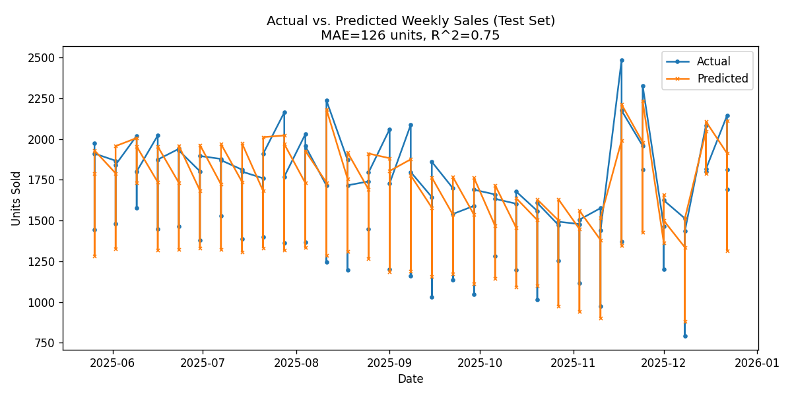
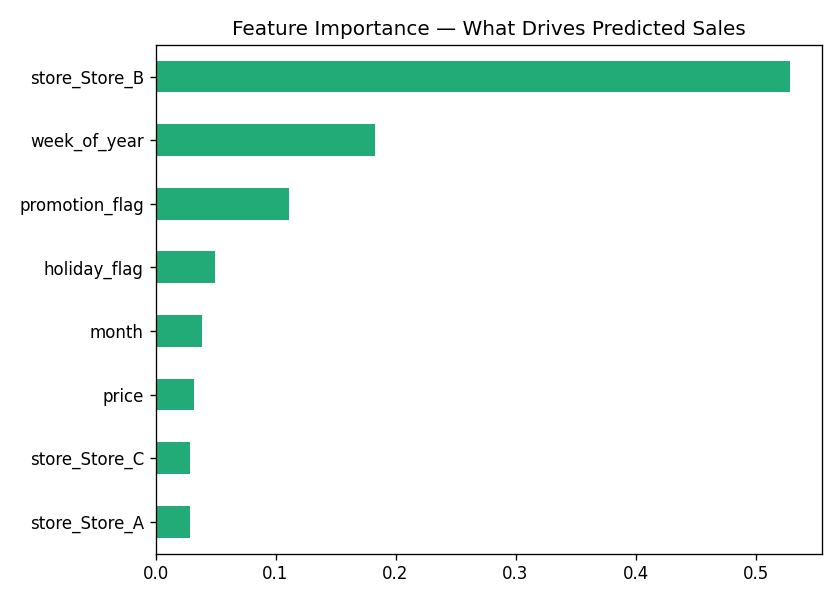

# Weekly Retail Sales Demand Forecasting

Predicting weekly product demand across multiple retail stores using a
Random Forest Regressor, to support inventory and staffing decisions.

## Problem

Retailers lose money two ways: overstocking (tied-up cash, markdowns,
waste) and understocking (lost sales, unhappy customers). Accurate
short-term demand forecasts let a business order and staff closer to
what it will actually need.

This project builds a model that predicts weekly units sold per store,
using price, promotions, holidays, and time-of-year patterns.

## Data

Weekly sales data across 3 stores over 3 years (468 rows), with:
`date`, `store`, `units_sold`, `price`, `promotion_flag`, `holiday_flag`.

The dataset is synthetically generated (see `src/generate_data.py`) to
mirror real retail dynamics — an underlying trend per store, yearly
seasonality, a holiday sales spike (Black Friday / Christmas weeks),
and a promotion effect — with random noise layered in. This keeps the
project fully reproducible with no external downloads; the generation
logic is fully documented in the script. **Swap in a real POS export
and the rest of the pipeline works unchanged.**

## Approach

1. **EDA** (`src/eda.py`) — checked overall trends, and the effect of
   promotions and holidays on sales volume.
2. **Feature engineering** — store (one-hot encoded), price, promotion
   flag, holiday flag, week-of-year, and month.
3. **Model** (`src/model.py`) — Random Forest Regressor, 300 trees. Used
   a **time-based train/test split** (not random shuffling) — this is
   the single most important decision in a forecasting project, since
   shuffling would let the model "see the future" during training and
   produce misleadingly good results.
4. **Evaluation** — Mean Absolute Error (MAE) and R², chosen because
   MAE is directly interpretable in units sold, which is what a store
   manager actually cares about.

## Results

| Metric | Value |
|---|---|
| MAE | 126.4 units |
| RMSE | 164.0 units |
| R² | 0.747 |

The model explains ~75% of week-to-week variance in sales and is off by
about 126 units on average — roughly 8% of average weekly volume.

**Actual vs. predicted (test period):**



**What drives the prediction:**



Store identity and holiday timing are the strongest predictors, followed
by week-of-year (seasonality) and promotions — matching what the EDA
showed directly.

## Business takeaway

- Holiday weeks (Black Friday, Christmas) reliably drive a
  ~25% lift in sales — worth planning inventory and staffing around
  specifically, not just "the holidays" generally.
- Promotions have a measurable but secondary effect compared to
  seasonality — useful context if promotion budget is limited and needs
  to be timed well rather than run constantly.
- A store manager could use this model's weekly forecast to set
  purchase order quantities 1-2 weeks out, reducing both stockouts and
  excess inventory.

## How to run this yourself

```bash
pip install -r requirements.txt
python src/generate_data.py   # creates data/sales_data.csv
python src/eda.py             # exploratory plots -> images/
python src/model.py           # trains model, evaluates, saves plots
```

## Tech stack

Python, pandas, NumPy, scikit-learn, Matplotlib

## Possible extensions

- Swap in real sales data via a POS/e-commerce export
- Try gradient boosting (XGBoost/LightGBM) and compare
- Add external features (weather, local events, competitor pricing)
- Wrap the trained model in a simple API for live forecasting
